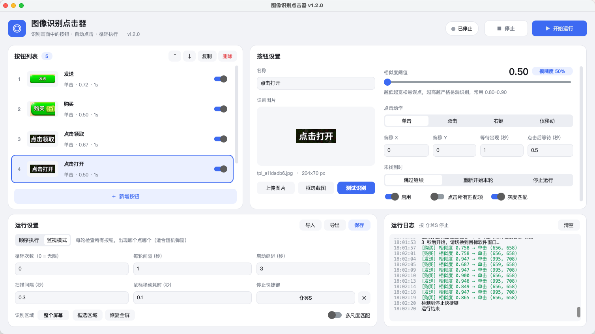

<div align="center">

# 🎯 AutoClicker · 图像识别点击器

**macOS / Windows 桌面自动化工具：识别屏幕上的按钮图片，自动点击、循环执行**


[](https://github.com/AnRan-727/AutoClicker/releases/latest)

<br>



</div>

---

## ✨ 功能特性

- **图片识别点击**：基于 OpenCV 模板匹配，在屏幕上找到你截取的按钮并点击
- **多按钮流程**：任意数量的按钮，可排序、复制、单独启用/禁用
- **两种运行模式**
  - **顺序执行**：按列表顺序依次等待并点击，适合固定流程（打开 → 确认 → 领取…）
  - **监视模式**：每轮检查所有按钮，出现哪个点哪个，适合处理随机弹窗
- **识别模糊度可调**：相似度阈值 0.50 ~ 1.00 滑块调节，实时显示模糊度
- **灵活的点击设置**：单击 / 双击 / 右键 / 仅移动，点击偏移、等待出现时间、点击后等待
- **失败处理**：未找到时可选择跳过、重新开始本轮或停止运行
- **循环控制**：循环次数（0 = 无限）、每轮间隔、启动延迟、扫描间隔
- **全局停止快捷键**：点击后直接按下组合键录制（默认 ⌃⇧S），任何软件在前台都能停止
- **紧急停止**：鼠标甩到屏幕左上角立即停止
- **屏幕框选截图**：直接在屏幕上框选按钮做模板，Retina 缩放自动处理
- **识别区域**：只在指定区域内识别，更快、更不容易误点
- **多尺度匹配 / 灰度匹配**：应对缩放不一致，或提升识别速度
- **现代化界面**：跟随系统浅色 / 深色模式，窗口缩放自适应
- **启动权限检测**（macOS）：自动检查所需系统权限并引导授权
- **跨平台**：macOS 与 Windows 共用同一套源码，界面和功能完全一致

## 📥 下载安装

前往 **[Releases](https://github.com/AnRan-727/AutoClicker/releases/latest)** 下载对应系统的安装包：

| 系统 | 下载文件 |
|---|---|
| macOS · Apple 芯片（M1 / M2 / M3 / M4…） | `AutoClicker-x.y.z-arm64.dmg` |
| macOS · Intel 芯片 | `AutoClicker-x.y.z-x86_64.dmg` |
| Windows 10 / 11（64 位）· 安装版 | `AutoClicker-x.y.z-Setup.exe` |
| Windows 10 / 11（64 位）· 免安装版 | `AutoClicker-x.y.z-win64-portable.zip` |

### macOS

> 不确定芯片类型？点左上角  → 关于本机，看「芯片」一栏。系统要求 **macOS 14 (Sonoma) 及以上**。

1. 双击 DMG，把 **AutoClicker** 拖进「应用程序」文件夹
2. 首次打开如果提示「无法验证开发者」或「已损坏」（本软件未经 Apple 公证），任选一种方式：
   - 系统设置 → 隐私与安全性 → 页面底部点「仍要打开」
   - 或在终端执行：
     ```bash
     xattr -cr /Applications/AutoClicker.app
     ```
3. 首次启动会显示授权页面，点「去授权」后在系统设置中打开 AutoClicker 的开关：

   | 权限 | 用途 |
   |---|---|
   | 屏幕录制 | 截图识别按钮（授权后需重启软件生效） |
   | 辅助功能 | 控制鼠标点击 |
   | 输入监控 | 全局停止快捷键 |

### Windows

1. 运行 `Setup.exe` 按提示安装（默认装到当前用户，无需管理员）；或解压免安装版，直接运行 `AutoClicker.exe`
2. 如出现「Windows 已保护你的电脑」（软件未购买代码签名证书）：点「更多信息」→「仍要运行」
3. Windows 不需要额外授权，打开即可使用
4. 如果要点击的程序是**以管理员身份运行**的，本软件也需要右键「以管理员身份运行」

## 🚀 使用方法

1. 点「**＋ 新增按钮**」，在右侧点「**框选截图**」，在屏幕上框选目标按钮（或「上传图片」）
2. 调整「**相似度阈值**」：常用 0.80 ~ 0.90，识别不到就调低，误点就调高
3. 点「**测试识别**」：鼠标会移到识别到的位置，日志显示相似度和耗时
4. 按需设置点击动作、偏移、等待时间和未找到时的处理
5. 在「运行设置」中选择模式、循环次数等，点「**▶ 开始运行**」，在启动延迟内切换到目标软件
6. 按停止快捷键（默认 macOS ⌃⇧S / Windows Ctrl+Shift+S）、点「停止」或把鼠标甩到屏幕左上角即可停止

### 截图小技巧

- 只截按钮本身**独特**的部分，避免包含会变化的背景、数字、倒计时
- 尽量用软件内的「框选截图」，在同一台显示器上截取最准
- 同一画面有多个相同按钮时，可打开「点击所有匹配项」

## ⚙️ 参数说明

| 参数 | 说明 |
|---|---|
| 相似度阈值 | 匹配得分达到该值才算找到；越低越宽松 |
| 等待出现 | 顺序模式下最多等待按钮出现的秒数，0 = 只检查一次 |
| 点击后等待 | 点击后停顿的秒数，给界面响应留时间 |
| 偏移 X / Y | 在识别中心基础上偏移点击位置（逻辑像素） |
| 每轮间隔 | 每轮结束后的等待；监视模式下即扫描频率 |
| 扫描间隔 | 等待按钮出现期间，两次截图之间的间隔 |
| 多尺度匹配 | 模板与屏幕缩放不一致时开启，速度会变慢 |
| 灰度匹配 | 忽略颜色、速度更快；需要区分颜色时不要开 |

配置和模板图片保存在 macOS `~/Library/Application Support/AutoClicker/`、Windows `%APPDATA%\AutoClicker\`，升级软件不会丢失。

## 🛠 从源码运行 / 自行打包

macOS 和 Windows 共用 `src/` 下的同一套源码，各自的打包目录只放打包配置。

```bash
git clone git@github.com:AnRan-727/AutoClicker.git
cd AutoClicker

# 直接运行（macOS 下权限需授予「终端」）
python3 -m venv .venv && source .venv/bin/activate     # Windows: .venv\Scripts\activate
pip install -r requirements.txt
python src/autoclicker.py
```

| 系统 | 打包方式 | 产物（`dist/` 下） |
|---|---|---|
| macOS | `bash mac_autoclicker/build_mac.command` | `.app` + `.dmg` |
| Windows | 双击 `windows_autoclicker/build_win.bat` | `Setup.exe` + 免安装 `zip` |

- 打包需要 Python 3.10+ 且 Tk ≥ 8.6.10，推荐 [python.org](https://www.python.org/downloads/) 官方安装包
- PyInstaller 不能跨系统编译：macOS 包要在 Mac 上打，Windows 包要在 Windows 上打；不方便时直接用 GitHub Actions
- macOS 首次打包会在「登录」钥匙串创建本机签名证书，之后重装软件无需重新授权
- Windows 生成安装包需要 [Inno Setup 6](https://jrsoftware.org/isdl.php)（没有时只生成免安装版）

详见 [mac_autoclicker/README.md](mac_autoclicker/README.md) 与 [windows_autoclicker/README.md](windows_autoclicker/README.md)。

### 发布新版本

1. 修改 `src/version.py` 中的版本号
2. 在 [CHANGELOG.md](CHANGELOG.md) 顶部按「新增 / 优化 / 修复」写好新版本说明（标题格式 `## v1.4.0`）
3. 提交并**先推送代码**：
   ```bash
   git commit -am "发布 v1.4.0"
   git push
   ```
   > 必须先推代码再推标签：标签指向的提交如果还不在任何分支上，GitHub 会拒绝自动创建 Release（403）
4. 二选一触发发布：
   - 推送版本标签：
     ```bash
     git tag -a v1.4.0 -m "AutoClicker v1.4.0"
     git push origin v1.4.0
     ```
   - 或在 GitHub → Actions → **Build & Release** → **Run workflow**，填写版本号

GitHub Actions 会用同一套源码分别在 Apple 芯片 Mac、Intel Mac、Windows 上打包，自动创建 Release、上传全部安装包，并附上更新说明和安装说明。

## 📁 项目结构

```
AutoClicker/
├── src/                        # 共享源码（macOS / Windows 同一套）
│   ├── autoclicker.py          # 界面（CustomTkinter）
│   ├── core.py                 # 截图、模板匹配、点击与循环调度
│   ├── version.py              # 版本号（唯一来源）
│   ├── make_icon.py            # 生成 .icns / .ico 图标
│   └── platforms/              # 平台适配层
│       ├── __init__.py         # 按系统选择实现、字体、数据目录
│       ├── mac_permissions.py  # macOS 权限检测与授权引导
│       ├── mac_hotkey.py       # macOS 全局快捷键（CGEventTap）与按键录制
│       ├── win_permissions.py  # Windows（无需授权，管理员提示）
│       └── win_hotkey.py       # Windows 全局快捷键（RegisterHotKey）与按键录制
├── mac_autoclicker/            # macOS 打包：AutoClicker.spec、build_mac.command
├── windows_autoclicker/        # Windows 打包：AutoClicker.spec、build_win.ps1/.bat、installer.iss
├── requirements.txt
└── CHANGELOG.md
```

## ❓ 常见问题

<details>
<summary>识别不到按钮？</summary>

- 先用「测试识别」看最高相似度，适当降低阈值
- 确认已授予「屏幕录制」权限（未授权时截图只有桌面壁纸）
- 目标程序需在**主显示器**上
- 模板是在别的显示器 / 缩放比例下截的，开启「多尺度匹配」或重新截图
</details>

<details>
<summary>鼠标不动或点击无效？</summary>

- macOS：检查「辅助功能」权限是否已打开；开关已打开仍无效时，在授权页点「去授权」会自动清除旧记录后重新授权
- Windows：目标程序以管理员身份运行时，本软件也需要右键「以管理员身份运行」
</details>

<details>
<summary>停止快捷键在其它软件里不起作用？</summary>

- macOS：需要「输入监控」权限。运行日志显示「全局停止快捷键已启用」即为全局生效；如显示橙色提示，请授权后重启软件
- Windows：日志提示「已被其它程序占用」时，换一个快捷键组合即可
</details>

<details>
<summary>别的 Mac 能用吗？</summary>

可以。macOS 需要对应芯片的安装包和 macOS 14+，首次打开按上文处理一次并在该电脑上授权；Windows 10 / 11（64 位）直接安装即可。
</details>

## ⚠️ 免责声明

本工具仅用于个人桌面自动化与学习交流。使用前请确认目标软件 / 游戏的用户协议是否允许自动化操作，因使用本工具产生的任何后果由使用者自行承担。
